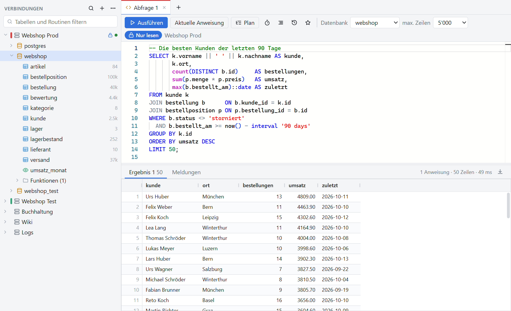
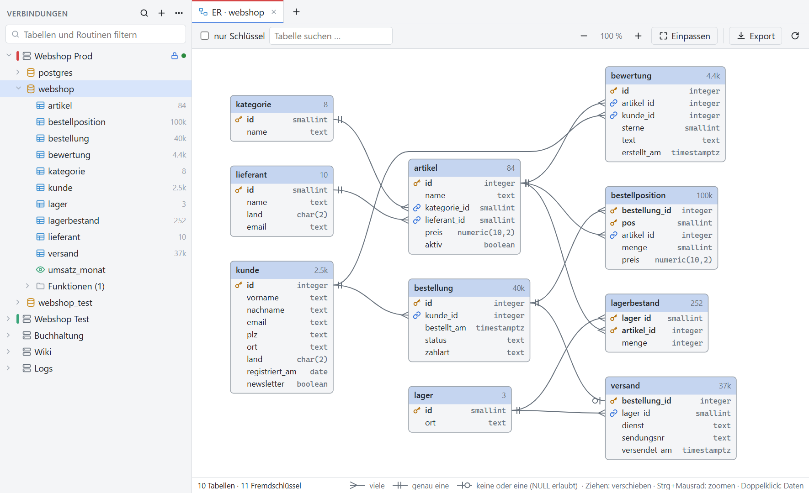
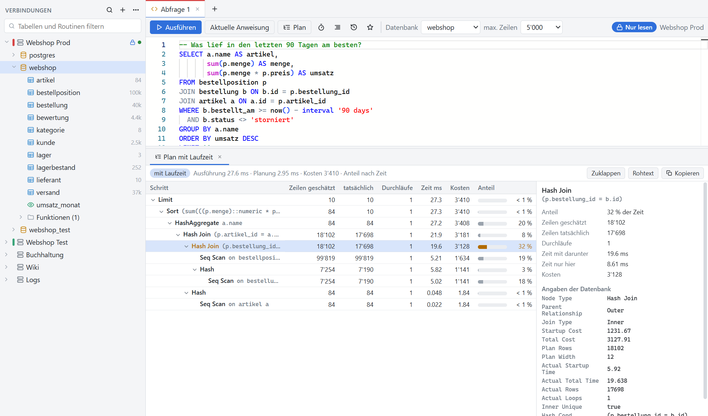
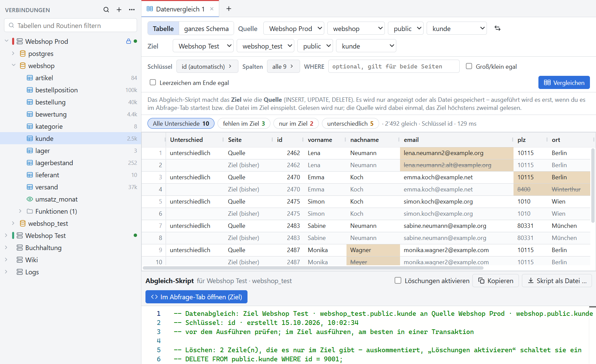
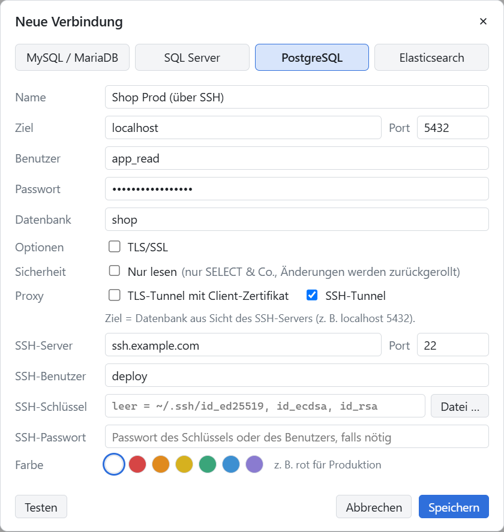

# OwlynDB


*One Tool to Bind Them.*

Schlanker Datenbank-Client für **MySQL/MariaDB, PostgreSQL, SQL Server** und **Elasticsearch**: Tabellen ansehen, Abfragen
ausführen, Daten vergleichen und kopieren – für Windows, macOS und Linux, hell oder dunkel.

**[Herunterladen](https://github.com/die-Anna/OwlynDB/releases/latest)** · [Handbuch](docs/handbuch.md) · [Selbst bauen](#selbst-bauen)

<picture>
  <source media="(prefers-color-scheme: dark)" srcset="docs/bilder/abfrage-dunkel.png">
  
</picture>

<sub>Alle Bilder zeigen einen erfundenen Webshop.</sub>

## Highlights

- **SSH-Tunnel eingebaut:** Die Datenbank hinter dem Jump-Host öffnet sich direkt – kein `ssh -L` im Terminal, kein PuTTY
  nebenher. Auch SSH durch einen TLS-Proxy mit SNI und Client-Zertifikat. [Beispiel](#ssh-tunnel)
- **Editor wie in VS Code** (Monaco): Vorschläge für Tabellen und Spalten, Formatieren, mehrere Ergebnisse, Verlauf und
  gespeicherte Abfragen. Jeder Abfrage-Tab hat seine eigene Verbindung – Transaktionen bleiben offen, bis du sie beendest.
- **Ausführungsplan wie in SSMS:** als Baum mit Anteilen, auf Wunsch mit gemessener Laufzeit je Schritt, dazu Hinweise auf
  weit danebenliegende Schätzungen, ganz gelesene Tabellen und fehlende Indizes.
- **ER-Diagramm** auf Knopfdruck, automatisch angeordnet, als Bild oder SVG.
- **Schema- und Datenvergleich:** Prod gegen Test, der Datenvergleich auch über Datenbanktypen hinweg. Das Abgleich-Skript
  macht das Ziel wie die Quelle – ausgeführt wird es erst, wenn du es startest.
- **Dump, Einspielen, Kopieren:** auch von MySQL nach PostgreSQL oder SQL Server, die Typen werden übersetzt. Liest die
  Dateien von mysqldump, pg_dump und SSMS, auch große.
- **Test-Datenbank aus Prod:** eine Teilmenge samt allen verwiesenen Zeilen, persönliche Daten anonymisiert – gleicher Wert,
  gleicher Ersatz, über alle Tabellen hinweg.
- **Durch die Daten klicken:** `Strg+Klick` auf einen Fremdschlüssel öffnet die verwiesene Zeile. Bearbeiten mit Vorschau
  der Anweisungen, Export nach Excel, CSV, JSON und SQL.
- **Sitzungen im Blick:** wer wen blockiert und was gerade läuft; Abfragen abbrechen, Sitzungen beenden.
- **Elasticsearch** lesen wie in der Kibana-Konsole oder per SQL, auch über 10 000 Treffer hinaus.
- **Sicher auf Prod:** *Nur lesen* je Verbindung (vor dem Senden geprüft, jede Ausführung wird zurückgerollt), Rückfrage vor
  `DELETE` ohne `WHERE`, Farbe für Produktion, Passwörter verschlüsselt vom Betriebssystem.

## Rundgang

**ER-Diagramm:** Fremdschlüssel von Spalte zu Spalte, verwiesene Tabellen links, verweisende rechts.

<picture>
  <source media="(prefers-color-scheme: dark)" srcset="docs/bilder/er-diagramm-dunkel.png">
  
</picture>

**Ausführungsplan mit Laufzeit:** Zeilen, Zeit und Anteil je Schritt; der teuerste ist gleich gewählt.

<picture>
  <source media="(prefers-color-scheme: dark)" srcset="docs/bilder/plan-dunkel.png">
  
</picture>

**Datenvergleich Prod gegen Test:** fehlende, überzählige und geänderte Zeilen, darunter das Abgleich-Skript.

<picture>
  <source media="(prefers-color-scheme: dark)" srcset="docs/bilder/datenvergleich-dunkel.png">
  
</picture>

## SSH-Tunnel

Die PostgreSQL-Datenbank `shop` nimmt nur Verbindungen vom eigenen Server an; von außen ist nur SSH offen. Statt

```bash
ssh -L 5432:localhost:5432 deploy@ssh.example.com
```

im Terminal hakst du in OwlynDB *SSH-Tunnel* an und trägst den SSH-Server ein:

<picture>
  <source media="(prefers-color-scheme: dark)" srcset="docs/bilder/ssh-tunnel-dunkel.png">
  
</picture>

*Ziel* ist die Datenbank **aus Sicht des SSH-Servers**, meist `localhost`. Den Fingerabdruck des Servers bestätigst du beim
ersten Mal wie bei `ssh`; ohne Angabe nimmt OwlynDB die Standardschlüssel aus `~/.ssh`. Der Tunnel-Port lauscht nur auf
`127.0.0.1`, Keepalive und Neuaufbau erledigt OwlynDB. Alle Felder erklärt das [Handbuch](docs/handbuch.md#ssh-tunnel).

## Installieren

Die Pakete liegen unter [Releases](https://github.com/die-Anna/OwlynDB/releases/latest):

| System | Datei | Hinweis |
|---|---|---|
| Windows 10/11 | `OwlynDB-Setup-<version>.exe` oder `OwlynDB-<version>-portable.exe` | ohne Administratorrechte; nicht signiert, also bei SmartScreen *Weitere Informationen → Trotzdem ausführen* |
| macOS | `OwlynDB-<version>-mac-arm64.dmg` (Apple Silicon), `…-mac-x64.dmg` (Intel) | nicht notarisiert: *Systemeinstellungen → Datenschutz & Sicherheit → Dennoch öffnen* |
| Linux | `OwlynDB-<version>-linux-x86_64.AppImage` oder `owlyndb_<version>_amd64.deb` | das AppImage braucht FUSE 2 (`libfuse2t64` bzw. `libfuse2`) |

Passwörter verschlüsselt das System: unter Windows DPAPI, unter macOS der Schlüsselbund, unter Linux der Schlüsselbund der
Arbeitsumgebung (ohne ihn fragt OwlynDB beim Verbinden). Mehr im [Handbuch](docs/handbuch.md#macos-und-linux).

## Selbst bauen

Mit Node.js 22 (ab 22.22.3) oder 24 (ab 24.15):

```bash
npm install
cd ui && npm install && cd ..
npm start          # bauen und starten
npm run dist       # Windows: Installer und portable .exe in release/ (macOS: dist:mac, Linux: dist:linux)
npm run test:unit  # Tests ohne Datenbank
```

Die übrigen Testreihen laufen gegen Docker-Container; wie, steht im [Handbuch](docs/handbuch.md#entwicklung). Releases für
alle drei Systeme baut GitHub Actions bei einem Tag `v*`.

## Mitmachen

Issues und Pull Requests sind willkommen, auf Deutsch oder Englisch – siehe [CONTRIBUTING.md](CONTRIBUTING.md).
Sicherheitslücken bitte nicht als öffentliches Issue, sondern privat über die „Security Advisories“ des Repositorys melden,
siehe [SECURITY.md](SECURITY.md).

## Lizenz

MIT, siehe [LICENSE](LICENSE). Die Lizenztexte der enthaltenen Bibliotheken stehen in
[THIRD-PARTY-NOTICES.txt](THIRD-PARTY-NOTICES.txt), auch im Programmordner der Installation. Für das Paket `buffers` 0.1.1
(über exceljs → unzipper → binary) hat der Autor keine Lizenz angegeben; das vermerkt die Datei dort.

**KI-Mitarbeit:** Code, Tests und Dokumentation entstehen in Zusammenarbeit mit Claude (Anthropic); die Commits tragen
`Co-Authored-By: Claude`. Das Eulen-Logo (`brand/owlyndb-logo.png`, daraus entstehen `build/icon.png`, `build/icon-512.png`,
`build/icon-mac.png`, `ui/public/logo.png`, `ui/public/favicon.png`) ist ebenfalls KI-erzeugt (ChatGPT) und nicht Teil der Lizenz.

Die Namen der unterstützten Datenbanken (MySQL, MariaDB, PostgreSQL, Microsoft SQL Server, Elasticsearch) sind Marken ihrer
Inhaber; dieses Projekt steht in keiner Verbindung zu ihnen. Die Software wird ohne Gewähr bereitgestellt – Schreibzugriffe
(Bearbeiten, Einspielen, Sitzungen beenden) wirken direkt auf die Datenbank. Die Docker-Testumgebung startet u. a. das
SQL-Server-Image von Microsoft mit `ACCEPT_EULA=Y` (Developer-Edition, nur für lokale Tests); alle Images stehen unter ihren
eigenen Lizenzen und gehören nicht zu OwlynDB.
