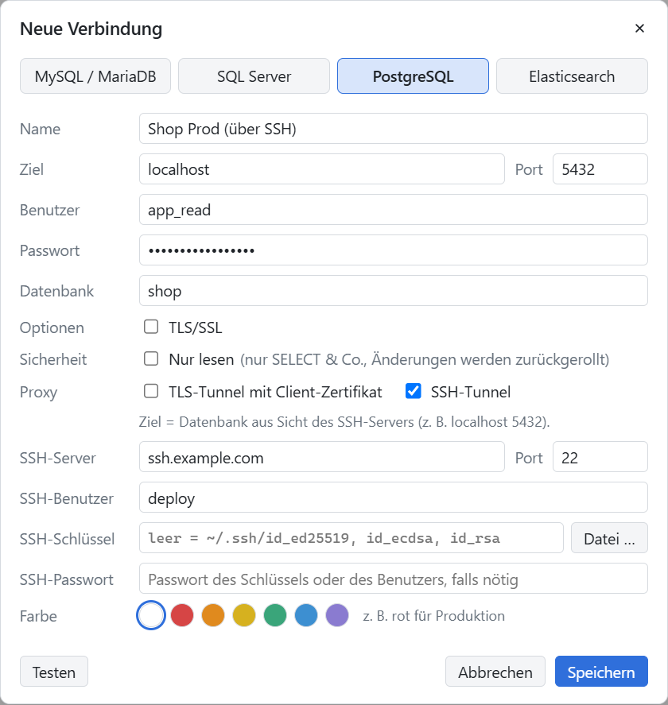

# OwlynDB


*One Tool to Bind Them.*

> **Früher AtlasDB:** Das Projekt hieß bis Oktober 2026 AtlasDB (davor dbviewer). Verbindungen und Einstellungen aus
> `%APPDATA%\AtlasDB` (und davor `%APPDATA%\dbviewer`) übernimmt OwlynDB beim ersten Start: Es arbeitet im bisherigen Profilordner
> weiter, die Daten werden nicht kopiert. OwlynDB wird als eigenes Programm installiert (neue App-ID) und ersetzt eine vorhandene
> AtlasDB-Installation nicht. Also AtlasDB vor dem ersten Start von OwlynDB schließen (beide teilen sich sonst dasselbe Profil, und ein
> zweiter Start holt dann nur das AtlasDB-Fenster nach vorn) und danach über „Apps“ deinstallieren; die Daten bleiben dabei im Profilordner.

Schlanker Datenbank-Client für **MySQL/MariaDB, SQL Server und PostgreSQL**: Tabellen ansehen und Abfragen ausführen.
Dazu **Elasticsearch** zum Lesen (siehe [unten](#elasticsearch)). Electron + Angular, die Treiber (mysql2, mssql, pg und ein
eigener HTTP-Client für Elasticsearch) laufen im Electron-Hauptprozess.

**Mit eingebautem SSH-Tunnel:** Datenbanken, die nur über einen SSH-Server erreichbar sind – die Produktion hinter dem
Jump-Host, die Datenbank auf dem Webserver –, verbindet OwlynDB direkt. Kein `ssh -L` im Terminal, kein PuTTY nebenher, kein
offener Port: Haken bei *SSH-Tunnel*, SSH-Server eintragen, fertig. [So geht's](#ssh-tunnel)

## Starten

Voraussetzungen: Windows 10/11, macOS oder Linux (64-bit; entwickelt und getestet vor allem unter Windows) und Node.js (getestet mit 22.23.1).
Die Angular-CLI 22 verlangt `^22.22.3`, `^24.15` oder `>=26`: also 22.x ab 22.22.3, 24.x ab 24.15 oder 26 und neuer, keine ungeraden Versionen wie 23 oder 25.
Docker braucht nur die Testumgebung (siehe [Entwicklung](#entwicklung)).

```bash
npm install
cd ui && npm install && cd ..
npm start
```

`npm start` baut Hauptprozess und Oberfläche und öffnet das Fenster.

## Windows-Programm bauen

```bash
npm run dist
```

Erzeugt in `release/`:

- `OwlynDB-Setup-<version>.exe` – Installer für den eigenen Benutzer (keine Administratorrechte nötig), legt Startmenü- und Desktop-Verknüpfung an
- `OwlynDB-<version>-portable.exe` – ohne Installation startbar

Das Deinstallieren (über „Apps“) hat einen eigenen Dialog (`build/installer.nsh`, hell oder dunkel wie die App): Auf Wunsch löscht
es auch die Daten – Verbindungen samt gespeicherter Passwörter, Verlauf, gespeicherte Abfragen und Einstellungen –, sonst bleiben sie
im Profilordner. Ein laufendes OwlynDB wird vorher geschlossen; bei ungespeicherten Änderungen fragt es selbst nach. Still (`/S`, so
auch bei Updates) läuft die Deinstallation wie gehabt ohne Dialog, mit `--delete-app-data` samt Daten.

Beide Varianten enthalten `LICENSE.txt` und `THIRD-PARTY-NOTICES.txt` (Lizenzhinweise der Bibliotheken): beim Installer im Programmordner
neben `OwlynDB.exe`, bei der Portable-Variante im Programmordner, den sie beim Start entpackt – nicht neben der `.exe`, ohnehin
liegen beide Dateien im Repository. `THIRD-PARTY-NOTICES.txt` wird mit `npm run notices` neu erzeugt (nach `npm run build:ui`), wenn sich
Abhängigkeiten ändern, vor `npm run dist`.

Die `.exe`-Dateien sind nicht signiert: Windows SmartScreen zeigt beim ersten Start „Unbekannter Herausgeber“ (*Weitere Informationen → Trotzdem ausführen*).
`npm run dist:dir` baut nur den entpackten Ordner `release/win-unpacked` (schneller, zum Testen). Die Symbole entstehen mit `npx electron dev/make-icon.js` aus dem Logo `brand/owlyndb-logo.png` (die App-Kachel unten rechts).
Verbindungen liegen in `%APPDATA%\OwlynDB\connections.json`, Passwörter verschlüsselt über Windows (DPAPI). Ein vorhandenes Profil
aus der Zeit als AtlasDB (`%APPDATA%\AtlasDB`) oder davor als dbviewer (`%APPDATA%\dbviewer`) erkennt OwlynDB beim ersten Start und
übernimmt es: Verbindungen, gespeicherte Abfragen, Verlauf und Passwörter bleiben erhalten.

## macOS und Linux

Fertige Pakete für alle drei Systeme baut GitHub Actions (`.github/workflows/release.yml`): Ein Tag `v*` legt einen Entwurf des
Releases mit allen Dateien an, der erst von Hand veröffentlicht wird; von Hand gestartet (*Actions → Release → Run workflow*) liegen
die Dateien als Artefakte am Lauf. Lokal baut jedes System nur für sich:

```bash
npm run dist:mac     # auf einem Mac
npm run dist:linux   # unter Linux
```

- **macOS:** `OwlynDB-<version>-mac-arm64.dmg` für Apple Silicon, `…-mac-x64.dmg` für Intel. Die App ist nur ad hoc signiert, nicht
  von Apple notarisiert (das bräuchte ein Apple-Entwicklerkonto). Beim ersten Öffnen meldet macOS deshalb, dass es OwlynDB nicht prüfen
  kann: *Systemeinstellungen → Datenschutz & Sicherheit → Dennoch öffnen*, oder im Terminal
  `xattr -dr com.apple.quarantine /Applications/OwlynDB.app`. Die Tastenkürzel nehmen dort ⌘ statt Strg, und die Oberfläche zeigt sie
  auch so an; nur die Vorschläge im Editor kommen wie üblich mit ⌃-Leertaste. Passwörter liegen im Schlüsselbund von macOS.
- **Linux:** `OwlynDB-<version>-linux-x86_64.AppImage` läuft ohne Installation (`chmod +x`, braucht FUSE 2 – unter Ubuntu
  `sudo apt install libfuse2t64` bzw. `libfuse2`), `owlyndb_<version>_amd64.deb` installiert nach `/opt/OwlynDB` samt Eintrag im
  Programmmenü (`sudo apt install ./owlyndb_<version>_amd64.deb`). Passwörter verschlüsselt der Schlüsselbund der Arbeitsumgebung
  (GNOME-Schlüsselbund, KWallet); ohne ihn speichert OwlynDB keine Passwörter – sie werden dann beim Verbinden abgefragt.

Das Profil liegt unter macOS in `~/Library/Application Support/OwlynDB`, unter Linux in `~/.config/OwlynDB`.

## Bedienung

- **Baum links**: Verbindung aufklappen, Tabelle anklicken öffnet die Daten. Rechtsklick für weitere Aktionen. Das Filterfeld filtert Tabellennamen.
  Rechtsklick auf eine Verbindung → *Duplizieren* legt eine Kopie mit allen Einstellungen und dem gespeicherten Passwort an (z. B. `prod-lesend` oder eine zweite Datenbank auf demselben Server) und öffnet sie gleich zum Anpassen; im Verbindungsdialog speichert *Als Kopie speichern* die Eingaben als neue Verbindung.
- **Tabellenansicht**: Suche über alle Spalten, freie `WHERE`-Bedingung (Enter), Sortieren per Klick auf den Spaltenkopf (auf dem Server), Seiten.
  Rechtsklick auf eine Zelle: Wert/Zeile kopieren, „Filtern: spalte = wert“. Doppelklick auf langen Text oder JSON öffnet den Wert.
  Reiter *Struktur* (Spalten, Indizes, Fremdschlüssel) und *DDL*.
- **Fremdschlüsseln folgen**: Spalten mit Fremdschlüssel sind gepunktet unterstrichen (im Kopf ein „→“). `Strg+Klick` auf den Wert
  öffnet die verwiesene Zeile; Rechtsklick bietet „→ tabelle öffnen“ und umgekehrt „← andere_tabelle mit spalte = wert“ (die Zeilen,
  die auf diese verweisen). Das Ziel öffnet sich als eigener Tab mit passendem `WHERE`. *Struktur* zeigt auch, wer auf die Tabelle verweist.
- **Bearbeiten** (Knopf in der Tabellenansicht; nur Tabellen mit Primärschlüssel bzw. eindeutigem Schlüssel ohne NULL, nicht bei
  *Nur lesen*): Doppelklick oder Enter ändert eine Zelle, `Strg+0` setzt NULL, *+ Zeile* fügt eine Zeile ein (leere Zellen bekommen
  den Standardwert der Datenbank), Rechtsklick löscht Zeilen oder verwirft Änderungen. Geänderte Zellen sind gelb, neue Zeilen grün,
  gelöschte durchgestrichen; solange etwas offen ist, sind Blättern, Sortieren und Filtern gesperrt. *Speichern* zeigt zuerst die Anweisungen.
  Ungespeicherte Änderungen: Schließen des Tabs, Beenden und *Neu laden* (Menü *Ansicht*, `Strg+Umschalt+R`) fragen vorher nach.
- **Abfrage** (`Strg+T`): `F5` / `Strg+Umschalt+Enter` führt alles bzw. die Markierung aus, `Strg+Enter` die Anweisung unter dem Cursor.
  Mehrere Ergebnisse erscheinen als eigene Reiter, Fehler werden im Editor markiert. MySQL versteht `DELIMITER`, SQL Server `GO`.
  SQL Server: `datetime2`, `time` und `datetimeoffset` erscheinen mit allen Nachkommastellen (`datetimeoffset` als UTC mit `+00:00`),
  `real` in kurzer Schreibweise; `decimal`/`numeric` über 15 Stellen liefert der Treiber in freien Abfragen gerundet (Hinweis in den
  Meldungen) – die Tabellenansicht, der Export einer Tabelle, Dump und Kopie lesen sie exakt. `FOR JSON`/`FOR XML` kommt als ein
  Wert, die Zeilengrenze greift dort nicht.
  Jeder Abfrage-Tab hat eine eigene Verbindung, Transaktionen und `USE` bleiben also erhalten. Abfrage-Tabs samt Text überleben einen Neustart.
  Angezeigt werden höchstens *max. Zeilen* (1 000 bis 100 000); auch ein riesiges Ergebnis landet nicht im Speicher. MySQL/MariaDB
  (`sql_select_limit`, wie Connector/J) und PostgreSQL (Cursor) hören danach von selbst auf; SQL Server bricht in einem lesenden Batch
  die letzte Ergebnismenge ab (ein Abbruch beendet den ganzen Batch – frühere Ergebnisse kommen deshalb ganz). Sonst wird der Rest nur
  gezählt („5 000 von 123 456 Zeilen“). Nicht begrenzt werden Pläne, `FOR UPDATE` (sonst wären nur die ersten Zeilen gesperrt) und
  Prozeduren. Binärwerte bis 1 KB erscheinen ganz, längere gekürzt.
- **Formatieren** (`Umschalt+Alt+F` oder Knopf im Abfrage-Tab): ganzer Text bzw. Markierung, passend zum Datenbanktyp; jede Anweisung
  einzeln, `GO`/`DELIMITER` und Prozeduren mit eigenem Trennzeichen bleiben unverändert. `Strg+Z` nimmt es zurück.
- **Ausführungsplan** (Knopf *Plan* bzw. `Strg+L` im Abfrage-Tab, wie in SSMS): Plan der Anweisung unter dem Cursor bzw. der
  Markierung als aufklappbarer Baum – je Schritt geschätzte Zeilen und Kosten, rechts alle Angaben der Datenbank. *Anteil* zeigt, was
  ein Schritt allein ausmacht (ab 20 % orange, ab 50 % rot; der teuerste ist gleich gewählt). Hinweise markieren Auffälliges: Schätzung
  weit daneben (veraltete Statistik?), ganze Tabelle gelesen (ab 10 000 Zeilen), Sortieren auf der Platte, implizite Typumwandlung;
  SQL Server nennt fehlende Indizes samt `CREATE INDEX`. *Rohtext* und *Kopieren* geben die Ausgabe der Datenbank weiter (z. B. für
  explain.dalibo.com oder als `.sqlplan` für SSMS). **Mit Laufzeit** (Uhr-Knopf, `Strg+M`) führt die Anweisung dabei aus und misst
  jeden Schritt (tatsächliche Zeilen, Durchläufe, Zeit); bei allem, was nicht nur liest, fragt OwlynDB vorher nach, und der Lauf steht
  im Verlauf. MySQL ab 8.0.16 (mit Laufzeit ab 8.0.18), MariaDB, PostgreSQL, SQL Server.
- **Verlauf und gespeicherte Abfragen** (Uhr- und Stern-Knopf im Abfrage-Tab): Jede Ausführung landet mit Zeit, Datenbank, Dauer und
  Ergebnis im Verlauf (`history.jsonl` im Profil, höchstens 5000 Einträge), durchsuchbar, je Verbindung oder alle. Klick fügt die Abfrage
  ein, „+“ öffnet sie in einem neuen Tab. `Strg+S` speichert Markierung bzw. Editor-Text unter einem Namen (`saved-queries.json`).
  Der Verlauf enthält das SQL samt Werten – er bleibt lokal im Profil und lässt sich löschen.
- **Prozeduren, Funktionen, Trigger** stehen im Baum in eigenen Ordnern unter der Datenbank bzw. dem Schema. Klick öffnet den Text in
  einem Abfrage-Tab, vorbereitet zum Ändern (SQL Server `CREATE OR ALTER`, PostgreSQL `CREATE OR REPLACE`; bei MySQL steht das nötige
  `DROP` auskommentiert davor). Rechtsklick auf eine Prozedur: Aufruf in neuer Abfrage.
- **Objektsuche** (Lupe oben im Baum, `Strg+Umschalt+F`, Rechtsklick auf Verbindung oder Datenbank): findet Tabellen, Views, Spalten,
  Prozeduren, Funktionen und Trigger in allen Datenbanken der Verbindung nach Namen (höchstens 300 Treffer, die Standard-Datenbank
  zuerst). PostgreSQL und SQL Server durchsuchen höchstens 50 Datenbanken (der Rest steht unter „nicht durchsucht“), SQL Server
  ohne `master`, `model`, `msdb` und `tempdb`, MySQL ohne die Systemdatenbanken. Pfeiltasten und Enter öffnen den Treffer – Tabellen
  in der Tabellenansicht, Routinen im Abfrage-Tab.
- **Sitzungen und laufende Abfragen** (Rechtsklick auf eine Verbindung): alle Verbindungen des Servers mit Benutzer, Datenbank,
  Zustand, Laufzeit, offener Transaktion und laufender bzw. letzter Abfrage; lädt alle 3 s neu. Oben steht, wer andere blockiert
  (rot, „blockiert 2“) und wer wartet („Sperre von 57“), dann Laufendes und offene Transaktionen; Leerlauf ist ausgeblendet.
  Eigene Abfrage-Tabs sind markiert („Abfrage 3“). Ein Klick zeigt den ganzen Text; *Abfrage abbrechen* (MySQL/MariaDB,
  PostgreSQL – SQL Server kann das nicht einzeln) und *Sitzung beenden* (eine offene Transaktion wird zurückgerollt) fragen
  vorher nach, bei *Nur lesen* gibt es nur die Anzeige. Wer nicht alle Sitzungen sieht, braucht dafür Rechte (MySQL `PROCESS`,
  PostgreSQL `pg_read_all_stats`, SQL Server `VIEW SERVER STATE`).
- **ER-Diagramm** (Rechtsklick auf Datenbank oder Schema → *ER-Diagramm*, auf eine Tabelle → *ER-Diagramm ab hier*): Tabellen mit
  Spalten und Typen, Fremdschlüssel als Linien von Spalte zu Spalte (Krähenfuß = viele, Doppelstrich = genau eine, Kreis = darf NULL
  sein), automatisch angeordnet: verwiesene Tabellen links, verweisende rechts, lange Linien laufen durch die Lücken zwischen den
  Tabellen. Klick hebt eine Tabelle mit ihren Nachbarn hervor, Doppelklick öffnet die Daten; Ziehen verschiebt eine Tabelle bzw. die
  Ansicht, `Strg+Mausrad` zoomt, *Einpassen* (`0`) zeigt alles, die Suche springt mit Enter von Treffer zu Treffer. *Ab hier* zeigt nur
  die Umgebung einer Tabelle (Nachbarn, 2 oder 3 Schritte, alle verbundenen); *nur Schlüssel* blendet die übrigen Spalten aus (ab 30
  Tabellen voreingestellt), lange Tabellen zeigen zuerst 24 Spalten. Verweise in ein anderes Schema bzw. eine andere Datenbank
  erscheinen als gestrichelter Platzhalter. *Export*: Bild in die Zwischenablage (PNG) oder SVG-Datei.
- `Strg+W` schließt den Tab, `Strg+Tab` wechselt – nicht, solange ein Dialog, der Wertbetrachter oder ein Menü offen ist.
- **Export** (Knopf in der Tabellenansicht, Download-Symbol bei Ergebnissen, Rechtsklick → *Exportieren …*): Excel, CSV, JSON, SQL-INSERT.
  In der Tabellenansicht wahlweise alle Zeilen mit aktuellem Filter/Sortierung (wird gestreamt, auch große Tabellen, lässt sich
  abbrechen) oder nur die Seite; bei Abfragen das geladene Ergebnis oder die markierten Zeilen. Ist das Ergebnis abgeschnitten (oder sind
  Binärwerte gekürzt), bietet der Dialog *alle Zeilen* an: Die Anweisung läuft dafür im Tab noch einmal und geht als Stream in die Datei
  (nur lesende Anweisungen, der Export lässt sich abbrechen und steht im Verlauf). Excel bekommt echte Zahlen und Datumswerte (ab 1900;
  ungültige wie `0000-00-00` bleiben Text), Kopfzeile fixiert mit Filter; Zellen über 32 767 Zeichen werden gekürzt und gemeldet, mehr
  als 1 048 575 Zeilen lehnt der Dialog vorab ab. Geschrieben wird in eine Nachbardatei `….part`, die erst am Ende die gewählte Datei
  ersetzt – bei Fehler oder Abbruch bleibt eine vorhandene Datei, wie sie war; ist sie gesperrt (z. B. in Excel offen), sagt der Export
  das. Ebenso beim Dump und beim Abgleich-Skript des Datenvergleichs. In CSV-Dateien bekommen Textzellen, die mit `=`, `+`, `-` oder `@`
  beginnen, einen Apostroph davor – Excel führte sie sonst als Formel aus (Zahlenspalten bleiben, wie sie sind; abschaltbar über
  `protectFormulas` der Export-Optionen).

## SSH-Tunnel

Die Datenbank ist nur über SSH erreichbar? Dann braucht es kein `ssh -L` im Terminal und kein PuTTY nebenher: OwlynDB baut den
Tunnel selbst auf, sobald die Verbindung geöffnet wird, und schließt ihn beim Trennen wieder. Das geht mit MySQL/MariaDB,
PostgreSQL, SQL Server und Elasticsearch.

- **Sicher wie `ssh`:** Den Fingerabdruck des SSH-Servers bestätigst du beim ersten Mal; ändert er sich später, warnt OwlynDB.
- **Nur für dich:** Der lokale Tunnel-Port lauscht nur auf `127.0.0.1`, OwlynDB wählt ihn selbst und schließt ihn mit der Verbindung.
- **Bleibt stehen:** Keepalive alle 15 s; reißt die Leitung trotzdem ab, baut OwlynDB den Tunnel beim nächsten Zugriff neu auf.
- **Schlüssel oder Passwort:** Ohne Angabe nimmt OwlynDB die Standardschlüssel aus `~/.ssh`; Passwörter liegen verschlüsselt im Profil.
- **Auch hinter einem TLS-Proxy** mit Client-Zertifikat (siehe [TLS und Client-Zertifikate](#tls-und-client-zertifikate)).

### Beispiel

Die PostgreSQL-Datenbank `shop` läuft auf einem Server und nimmt nur Verbindungen von dort selbst an (`localhost:5432`).
Von außen erreichbar ist nur SSH: `ssh.example.com`, Anmeldung als `deploy` mit Schlüssel. Im Terminal wäre das

```bash
ssh -L 5432:localhost:5432 deploy@ssh.example.com
```

In OwlynDB unter *Verbindung anlegen*:



| Feld | Eintrag | Bedeutung |
|---|---|---|
| Typ | PostgreSQL | |
| Proxy | *SSH-Tunnel* angehakt | |
| Ziel, Port | `localhost`, `5432` | die Datenbank **aus Sicht des SSH-Servers**, nicht von deinem PC aus. Läuft sie auf einem anderen Rechner im internen Netz: dessen Name, z. B. `db01.intern` |
| Benutzer, Passwort, Datenbank | `app_read`, …, `shop` | Anmeldung an der Datenbank, wie ohne Tunnel |
| SSH-Server, Port | `ssh.example.com`, `22` | der Rechner, auf dem du dich mit `ssh` anmeldest |
| SSH-Benutzer | `deploy` | |
| SSH-Schlüssel | leer | leer = `~/.ssh/id_ed25519`, `id_ecdsa`, `id_rsa`; sonst die Schlüsseldatei wählen (OpenSSH oder PuTTY-.ppk Version 2, Version 3 in PuTTYgen als OpenSSH exportieren) |
| SSH-Passwort | leer oder … | die Passphrase des Schlüssels – oder das Passwort des SSH-Benutzers, wenn es keinen Schlüssel gibt |

*Testen* prüft die Verbindung samt Tunnel, bevor du speicherst. Beim ersten Mal fragt OwlynDB nach dem Fingerabdruck des
SSH-Servers: vergleichen und bestätigen, wie bei `ssh`. Eine lokal laufende Datenbank auf Port 5432 stört nicht, OwlynDB nimmt für
den Tunnel einen freien Port.

Häufigster Stolperstein: *Ziel* von deinem PC aus gedacht, etwa mit dem öffentlichen Namen des Servers. Die Verbindung zur
Datenbank baut der SSH-Server auf – aus seiner Sicht ist sie meist `localhost`.

## TLS und Client-Zertifikate

Im Verbindungsdialog: CA als **PEM**; das Client-Zertifikat als PEM (Zertifikat und Schlüssel getrennt oder in einer Datei) oder als
**PKCS#12** (.p12/.pfx) mit Passwort – dann bleibt das Feld *Schlüssel* leer, und *P12-Passwort* ist das Passwort der Datei:

- **TLS im Datenbank-Protokoll** (MySQL/PostgreSQL: *TLS/SSL*, SQL Server: *verschlüsseln*): CA, Client-Zertifikat und Schlüssel
  (optional mit Passwort), Prüfung von Serverzertifikat und Hostname einzeln schaltbar. SQL Server selbst nimmt kein Client-Zertifikat an.
  Ohne gespeicherte Einstellung verbindet der SQL-Server-Treiber verschlüsselt und prüft das Zertifikat (*Serverzertifikat vertrauen*
  schaltet die Prüfung ab; mit eigener CA wird immer geprüft). Neue SQL-Server-Verbindungen legt der Dialog verschlüsselt an, mit
  *Serverzertifikat vertrauen* für die selbst signierten Zertifikate, die SQL Server ohne eigenes Zertifikat verwendet; ohne
  Verschlüsselung warnt er, dass Passwort und Daten im Klartext übers Netz gehen. Über eine SSH-Weiterleitung prüfen alle Treiber
  das Zertifikat gegen den echten Servernamen, nicht gegen `127.0.0.1`.
- **TLS-Tunnel mit Client-Zertifikat** (*Proxy*): die ganze Verbindung läuft von Anfang an über TLS – für einen Proxy davor
  (nginx stream, HAProxy, stunnel …), der das Client-Zertifikat prüft und dann zur Datenbank weiterreicht. Geht mit allen drei Datenbanken.
  Server/Port = der Proxy. Für SNI-Weiterleitung den Hostnamen eintragen oder bei einer IP den *SNI-Namen* setzen.
  Zertifikat und Schlüssel dürfen in einer Datei liegen (Feld *Schlüssel* leer lassen), wie bei `openssl s_client -cert`.
- **SSH-Tunnel** (*Proxy*, wie `ssh -L`): Einrichtung mit Beispiel im Abschnitt [SSH-Tunnel](#ssh-tunnel). Mit *TLS-Tunnel*
  zusammen läuft SSH im TLS-Tunnel zum Proxy, also wie
  `ssh -L 1433:localhost:1433 -o ProxyCommand="openssl s_client -quiet -connect <proxy>:<port> -servername <sni> -cert <pem>" <user>@…`:
  SSH-Server/Port = Proxy, *SNI-Name* = `-servername`, *Client-Zert.* = `-cert`.
  Der Hostschlüssel wird beim ersten Kontakt per Rückfrage bestätigt (Fingerabdruck wie bei `ssh`) und in `ssh-host-keys.json`
  im Profil gemerkt; ein geänderter Schlüssel führt zu einer Warnung. Der lokale Tunnel-Port lauscht nur auf `127.0.0.1` und schließt
  beim Trennen. SSH sendet alle 15 s ein Keepalive; reißt SSH trotzdem ab, wird es beim nächsten Zugriff neu aufgebaut
  (auch hier: erst nur neu verbinden, nichts ausführen).

Proxys schließen Verbindungen, über die eine Weile nichts läuft (HAProxy: `timeout client`/`timeout server`).
Deshalb schicken offene Abfrage-Tabs alle 20 s ein Lebenszeichen (`SELECT 1`). War eine Sitzung trotzdem weg, wird sie beim
nächsten Ausführen neu aufgebaut, und eine gelbe Leiste weist darauf hin, dass Transaktion und temporäre Tabellen verloren sind
(SQL Server verbindet sonst still neu; erkannt wird das über ein Kennzeichen in `SESSION_CONTEXT`).

Passwörter, Schlüssel- und SSH-Passwörter liegen nur verschlüsselt (DPAPI) im Profil, von Zertifikaten wird nur der Pfad gespeichert.

## Dump und Einspielen

Rechtsklick im Baum:

- **Dump erstellen …** (Datenbank, Schema oder Tabelle): Objekte wählen, *Struktur und Daten* / *nur Struktur* / *nur Daten*,
  optional `DROP … IF EXISTS` vorab. Die Datei hat die Reihenfolge Typen → Tabellen → Daten → Indizes → Fremdschlüssel → Views
  (jede hinter denen, die sie benutzt) und lässt sich deshalb ohne Sortierung einspielen. Identitätsspalten laufen danach hinter
  dem höchsten Wert weiter (auch bei *nur Daten*). Mit kommen im selben Datenbanktyp: berechnete Spalten mit ihrem Ausdruck,
  `rowversion`, CHECK-Einschränkungen, Fremdschlüssel samt `ON DELETE`/`ON UPDATE`, Indizes im Wortlaut des Servers (Teilindizes,
  Ausdrücke, FULLTEXT, INCLUDE, Präfixlängen), MySQL `ON UPDATE CURRENT_TIMESTAMP`, Zeichensatz und Kollation der Tabellen,
  PostgreSQL ENUM- und DOMAIN-Typen sowie SQL-Server-Aliastypen, materialisierte Sichten. Zeitstempel werden in UTC gelesen und
  geschrieben, damit sie nicht von der Zeitzone der Server abhängen. *Vorher löschen* löscht nur die Objekte des Dumps, ohne
  `CASCADE`: hängt im Ziel etwas anderes daran (eine View, ein Fremdschlüssel einer fremden Tabelle), scheitert das Löschen mit
  Fehler, statt dass es still verschwindet. Partitionierte, versionierte und Fremdtabellen kommen als normale Tabellen (mit
  Hinweis); Sequenzen sind nicht dabei, ein Standardwert, der eine braucht, fällt mit Hinweis weg.
  **Für** einen anderen Datenbanktyp übersetzt OwlynDB Spaltentypen und Werte (z. B. `boolean` ↔ `bit` ↔ `tinyint(1)` – wobei
  `tinyint(1)` im selben Typ eine Zahl bleibt –, `text` ↔ `nvarchar(max)`, PostgreSQL-Arrays → JSON, `numeric` ohne Genauigkeit →
  die größte des Ziels, Zähler auf `bigint unsigned` → `bigint`, Standardwerte wie `CURRENT_TIMESTAMP`, `CURRENT_DATE` und UUID-
  Funktionen; berechnete Spalten werden normale Spalten mit den gelesenen Werten, ein eindeutiger Index mit NULL-Spalten wird in
  SQL Server gefiltert). Views, CHECK-Einschränkungen, Teil- und Ausdrucks-Indizes und nicht übersetzbare Standardwerte fallen
  dabei weg; der Dump nennt sie als Hinweis. Gelesen wird wie beim Export in einer Nur-lese-Transaktion je Tabelle (kein
  gemeinsamer Schnappschuss über alle Tabellen); ein INSERT ist höchstens 1 MB groß.
- **SQL-Datei einspielen …** (Datenbank): in die gewählte oder eine **neu angelegte** Datenbank. Liest auch große Dateien
  stückweise und versteht die Dateien von mysqldump (`DELIMITER`, `/*! … */`), pg_dump im Textformat (`COPY … FROM stdin`,
  `\restrict`) und SSMS (`GO`, UTF-16). Die Kodierung erkennt OwlynDB selbst: BOM, UTF-16 (auch ohne BOM), die im Kopf
  deklarierte Kodierung (`SET NAMES latin1`, `SET client_encoding = 'LATIN1'`), sonst UTF-8; ist der Anfang kein gültiges UTF-8,
  liest es die Datei als Windows-1252 und sagt das im Protokoll. Ungültige Bytes weiter hinten sind ein Fehler mit Zeilennummer, nie
  stille Ersatzzeichen. Diese Kodierungs-Anweisungen der Datei gehen nicht an den Server (die Verbindung bleibt auf UTF-8); Dumps von
  mysqldump ohne `--hex-blob` (Binärwerte als Rohbytes) lehnt OwlynDB mit Hinweis ab, gz/zip/pg_dump-Archive ebenso.
  `USE` sowie `DROP`/`CREATE`/`ALTER DATABASE` der Datei werden standardmäßig übersprungen (sie träfen die Quell-Datenbank auf dem
  Zielserver, bis hin zu `DROP DATABASE`); bei SQL Server ohne `GO` fällt nur die `USE`-Zeile weg. Warnungen des Servers (z. B. gekürzte
  Werte – mysqldump schaltet den strikten Modus ab) zählt der Status mit und nennt sie am Ende im Protokoll.
  Optionen: beim ersten Fehler aufhören (mit Zeilennummer) oder Fehler überspringen; bei PostgreSQL und SQL Server alles in einer
  Transaktion (Fehler = nichts übernommen). MySQL kennt das nicht (DDL schreibt sofort fest); dort bündelt OwlynDB einzelne
  INSERT/UPDATE/DELETE in Transaktionen zu bis zu 200 Anweisungen, solange die Datei keine eigene führt – auf dem Testserver 0,9 statt
  11 ms je Anweisung. Nach außen bleibt es wie einzeln: bei einem Fehler bleibt, was davor lief. Vor dem Start fragt OwlynDB mit Ziel
  und Datei nach. Auf Verbindungen mit *Nur lesen* ist Einspielen gesperrt.
- **Kopieren nach …** (Datenbank, Schema oder Tabelle): Dump und Einspielen in einem Schritt, ohne Datei – z. B. Prod → Test
  oder eine Sicherungskopie auf demselben Server. Objekte und Inhalt wie beim Dump, dazu die Zielverbindung und eine vorhandene oder
  **neue** Datenbank (Vorschlag: `<name>_kopie` auf demselben Server, überschreibt nichts). Ist das Ziel ein anderer Datenbanktyp,
  werden die Typen übersetzt wie beim Dump. Beide Seiten laufen gleichzeitig über einen Datenstrom, auch große Tabellen brauchen
  kaum Speicher; *Abbrechen* hält beide an. Optionen wie beim Einspielen (Transaktion bei PostgreSQL/SQL Server, beim ersten
  Fehler aufhören). Die Quelle darf auf *Nur lesen* stehen, das Ziel nicht; Quelle und Ziel dürfen nicht dieselbe Datenbank sein
  (auch nicht über eine zweite Verbindung zum selben Server – OwlynDB fragt dazu beide Server nach ihrer Kennung, der Name der
  Verbindung zählt nicht). Eine neue Datenbank entsteht in UTF-8 (`utf8mb4` bzw. `ENCODING 'UTF8'`). Vor dem Start fragt OwlynDB
  mit Quelle, Ziel und `DROP`-Hinweis nach.

**Test-Datenbank aus Prod** (beim Dump und beim Kopieren, sobald Daten dabei sind):
- **Teilmenge:** Je Tabelle wählst du *alle Zeilen*, *die letzten N* nach einer Spalte, eine *WHERE*-Bedingung, *abhängige Zeilen*
  oder *keine Zeilen*. *Abhängige Zeilen* sind die, die auf mitkommende Zeilen einer Tabelle mit eigener Auswahl verweisen – z. B. die
  Positionen der letzten 100 Bestellungen (nicht aber alle Positionen der Artikel, die dabei mitkommen).
- **Verweise:** Zeilen, auf die per Fremdschlüssel verwiesen wird, kommen immer mit – über alle Stufen, auch über Selbstbezüge und
  Verweise auf eindeutige Spalten. So passt die Kopie zusammen; die Fremdschlüssel werden im Ziel wieder angelegt. Nicht gewählte
  Tabellen, auf die verwiesen wird, ergänzt OwlynDB auf Wunsch, nur mit den nötigen Zeilen.
- **Ablauf:** OwlynDB plant zuerst und liest dabei nur Schlüssel- und Fremdschlüsselspalten. Danach schreibt es genau die geplanten
  Zeilen, auch wenn sich die Quelle zwischendurch ändert. Ausnahme sind Tabellen ohne Schlüssel: Für sie wird die Regel beim Schreiben
  noch einmal angewandt.
- **Anonymisieren:** Je Spalte gilt eine Regel: Name, Vor- oder Nachname, E-Mail (an `example.invalid`), Telefon (Vorwahl und
  Schreibweise bleiben), IBAN (gültige Prüfziffer, erfundene Bank), Strasse (PLZ und Ort bleiben), Geburtsdatum (das Jahr bleibt; auch
  als Text wie `23.07.1984`, `07/23/1984` oder `19840723`), Pseudonym oder leeren. Vorschläge kommen anhand der Spaltennamen, auch für
  Tabellen, die per Fremdschlüssel ergänzt werden. In Zahlenspalten (z. B. Telefon als `bigint`) ersetzt jede Regel die Ziffern – gleich
  viele, nie mehr, als der Typ fasst; *leeren* setzt dort NULL bzw. 0. Binärspalten werden als Text ersetzt. Was sich nicht ersetzen
  lässt (z. B. ein Geburtsdatum in unbekanntem Format), wird geleert und im Protokoll gezählt – nie unverändert übernommen.
- **Gleichbleibender Ersatz:** Gleicher Wert ergibt gleichen Ersatz, auch in anderen Tabellen. Spalten, die per Fremdschlüssel daran
  hängen, folgen automatisch (bei verschiedenen Regeln gilt die des Elternteils; *leeren* geht nie auf den Elternteil über). Der
  Schlüssel dafür ist zufällig je Lauf und wird nicht gespeichert – zurückrechnen lässt sich nichts.
- **Eindeutig bleibt eindeutig:** Zahlen, Telefonnummern und Ziffernfolgen werden umkehrbar eindeutig vertauscht, E-Mails und Pseudonyme
  tragen 48 Bit Prüfsumme. Liegt eine Spalte mit Namens- oder Strassen-Regel in einem Primärschlüssel oder eindeutigen Index, bekommt
  der Ersatz in allen Spalten dieser Regel einen Prüfsummen-Anhang. Die Form gilt für den ganzen Lauf, nicht je Spalte: ist eine
  E-Mail-Spalte zu schmal für die Langform, nehmen alle die Kurzform `u…@example.invalid` – so bleiben gleiche Werte gleich.

Prozeduren, Funktionen und Trigger nimmt der Dump beim gleichen Datenbanktyp mit (Funktionen vor den Views, Trigger erst nach den
Daten, damit sie beim Einspielen nicht auslösen). Rechte und Benutzer enthält er nicht.

## Schema-Vergleich

Rechtsklick auf eine Datenbank bzw. ein Schema → **Schema vergleichen …** öffnet einen Vergleichs-Tab. Quelle und Ziel wählen
(gleicher Datenbanktyp, auch über zwei Verbindungen – z. B. Prod gegen Test), dann *Vergleichen*. Verglichen werden Tabellen (Spalten
mit Typ, NULL, Standardwert, berechnetem Ausdruck und MySQL `ON UPDATE`, Primärschlüssel, Indizes samt Eigenschaften, Fremdschlüssel
samt `ON DELETE`/`ON UPDATE`, CHECK-Einschränkungen), Views und Routinen. Vergleicht man zwei Schemas (etwa `public` gegen
`staging`), schreibt das Skript Routinen, Trigger und Views auf das Ziel-Schema um – SQL Server auch die Verweise im Rumpf –, und der
Textvergleich lässt den Schemanamen außen vor.

Rechts entsteht das **Abgleich-Skript**, das das Ziel wie die Quelle macht – in einer Reihenfolge, die Abhängigkeiten berücksichtigt
(alte Fremdschlüssel/Indizes weg, Tabellen, neue Indizes/Fremdschlüssel, Views, Routinen). Löschungen (Spalten und Objekte, die es nur im
Ziel gibt) sind auskommentiert, bis du sie aktivierst; sie stehen in der Reihenfolge, die der Server zulässt (Fremdschlüssel, Indizes,
Spalten, dann Routinen, Views und zuletzt ganze Tabellen – verweisende vor den Tabellen, auf die sie zeigen). SQL Server: gespeicherte
`ALTER`-Texte werden zu `CREATE OR ALTER`, eine `DEFAULT`-Einschränkung wird vor einer Typänderung oder dem Löschen der Spalte
entfernt. Indizes, die zu einer `UNIQUE`-Einschränkung gehören, laufen über `ALTER TABLE … CONSTRAINT`. Ausgeführt wird nichts von selbst: *Im Abfrage-Tab öffnen (Ziel)* legt das Skript
in einen Abfrage-Tab auf dem Ziel. Nicht automatisch angepasst werden Änderungen an Primärschlüssel und Identität (sie stehen als Hinweis
da); Spaltenreihenfolge und Kommentare zählen nicht als Unterschied.

## Datenvergleich

Rechtsklick auf eine Tabelle → **Daten vergleichen …** öffnet einen Vergleichs-Tab. Quelle ist die Tabelle, als Ziel schlägt OwlynDB
eine Datenbank mit ähnlichem Namen (z. B. `shop_test` zu `shop`) und die gleichnamige Tabelle vor; beides lässt sich frei wählen, auch
auf einer anderen Verbindung oder einem anderen Datenbanktyp. Die Zeilen werden über den Primärschlüssel einander zugeordnet (sonst
einen eindeutigen Index ohne NULL; unter *Schlüssel* lassen sich eigene Spalten wählen). Verglichen werden alle Spalten, die es auf
beiden Seiten gibt (*Spalten* schränkt ein). Dazu optional eine WHERE-Bedingung für beide Seiten sowie „Groß/klein egal“ und
„Leerzeichen am Ende egal“.

Das Ergebnis zeigt Zeilen, die im Ziel fehlen (grün), die es nur im Ziel gibt (durchgestrichen) und geänderte Zeilen. Bei geänderten
Zeilen steht unter der Zeile der Quelle der bisherige Stand im Ziel, die geänderten Zellen sind markiert; die Knöpfe oben filtern.
Darunter steht das **Abgleich-Skript**, das das Ziel wie die Quelle macht: INSERT, UPDATE nur der geänderten Spalten und DELETE.
Löschungen sind auskommentiert, bis du sie aktivierst. Ausgeführt wird nichts von selbst; *Im Abfrage-Tab öffnen (Ziel)* legt das
Skript in einen Abfrage-Tab. Für Identitätsspalten setzt das Skript bei SQL Server `SET IDENTITY_INSERT`, bei PostgreSQL
`OVERRIDING SYSTEM VALUE` und zieht danach die Sequenz nach.

Die Zuordnung geht über den Schlüssel, nicht über die Sortierung; unterschiedliche Kollationen stören also nicht. Zuerst liest
OwlynDB das Ziel und merkt sich je Zeile nur Schlüssel und Prüfsumme. Dann liest es die Quelle (z. B. Prod) einmal und vergleicht.
Nur wenn es Unterschiede gibt, liest es das Ziel ein zweites Mal für die bisherigen Werte. 100 000 Zeilen dauern unter einer
Sekunde. Das Ziel darf bis 5 Mio. Zeilen haben; Liste und Skript zeigen je Art die ersten 5000 Unterschiede, gezählt wird alles.
Über Datenbanktypen hinweg werden die Werte vereinheitlicht: 1.50 = 1.5, Boolean = 0/1, Datum ohne 00:00:00, UUID klein, JSON mit
sortierten Schlüsseln.

**Skript als Datei** (Knopf am Skript): vergleicht noch einmal und schreibt das ganze Abgleich-Skript ohne Obergrenze direkt in eine
Datei – die Unterschiede bleiben dabei nicht im Speicher. UPDATE setzt hier alle verglichenen Spalten. Danach *Im Ziel einspielen …*:
der bekannte Dialog „SQL-Datei einspielen“, Datei und Zieldatenbank schon gewählt (fragt vorher nach). Bei MySQL bringt das Skript
seine Transaktion selbst mit.

**Ganzes Schema** (Umschalter oben, Rechtsklick auf Datenbank bzw. Schema → *Daten vergleichen …*, oder *Daten vergleichen* im
Schema-Vergleich): alle Tabellen, die es auf beiden Seiten gibt, nacheinander – je Tabelle über ihren Primärschlüssel. Die Übersicht
zählt je Tabelle. Für Tabellen ohne Schlüssel wählst du dort die Schlüsselspalten (*Schlüssel wählen …*, auch *alle Spalten*), die
Tabelle wird gleich verglichen; *Schlüssel …* in einer Zeile ändert ihn auch bei Tabellen mit Schlüssel. Ein Klick auf eine Tabelle
zeigt ihre Zeilen und ihr Skript (mit dem gewählten Schlüssel). *Skript als Datei* schreibt den Abgleich aller Tabellen in der Reihenfolge der Fremdschlüssel: erst die
Löschungen (verweisende Tabellen zuerst), dann je Tabelle Änderungen und Einfügungen (Tabellen, auf die verwiesen wird, zuerst); bei
MySQL zusätzlich mit `FOREIGN_KEY_CHECKS = 0`.

## Elasticsearch

OwlynDB liest Elasticsearch – geschrieben wird dort nichts (gebaut und getestet für 7.17, 8.10 und 9.5; die Version wird beim
Verbinden erkannt, OpenSearch und Elasticsearch vor 7.12 bekommen einen Hinweis „nicht geprüft“). Im Verbindungsdialog
*Elasticsearch* wählen (Port 9200). Anmeldung: keine, Benutzer und Passwort oder *API-Key statt Benutzer* (ins Passwortfeld kommt
der Key, wie `POST _security/api_key` ihn als „encoded“ liefert, oder `id:schlüssel`). Ein Benutzer ohne Cluster-Recht `monitor`
kann trotzdem verbinden (Name und Version bleiben dann unbekannt); die Indexliste braucht `monitor` oder `view_index_metadata`,
die Spalten mit nur `read` kommen aus `_field_caps` (ohne Datumsformat). *HTTPS* hat dieselben Zertifikatsoptionen wie TLS bei
den anderen Datenbanken (CA, Prüfen, Client-Zertifikat, SNI) – auch für einen Proxy davor, der das Client-Zertifikat prüft; eine
Umleitung des Proxys (301/302) meldet OwlynDB mit Ziel. Der SSH-Tunnel geht wie gewohnt (Ziel aus Sicht des SSH-Servers, z. B.
`localhost 9200`).

- **Baum:** der Cluster als einzige „Datenbank“, darunter Indizes und Data Streams als Tabellen, Aliase als Views (versteckte und
  Systemindizes nicht). Die Zahl neben einem Index zählt die Dokumente wie eine Suche (eine Aggregation nach `_index` über alle
  Indizes) – ohne die verschachtelten (`nested`), die `_cat/indices` und Kibanas Indexverwaltung mitzählen.
- **Tabellenansicht:** Spalten aus dem Mapping (Objekte aufgelöst wie `adresse.plz`, `nested` und Listen als JSON), vorne `_id`, bei
  Aliasen auch `_index`. Die WHERE-Bedingung ist SQL von Elasticsearch, z. B. `ort = 'Bern' AND MATCH(notiz, 'Fehler')` (OwlynDB
  übersetzt sie mit `_sql/translate`); die Suche findet Wörter in allen Feldern, auf `keyword`-Feldern auch ohne Rücksicht auf
  Groß- und Kleinschreibung. Textfelder lassen sich nur über ein `keyword`-Unterfeld sortieren. Ausgefallene Shards (roter Index)
  sind ein Fehler, kein stilles Teilergebnis; ein geschlossener Index wird als solcher gemeldet. Über Treffer 10 000
  (`index.max_result_window`) hinaus blättert OwlynDB mit Point-in-Time und `search_after` (ab Elasticsearch 7.12): Merkpunkte machen
  Weiter und Zurück billig, die letzten Seiten kommen von hinten (die Gesamtzahl stammt aus demselben Point-in-Time); *Neu laden*
  beginnt mit frischem Stand. Der Export holt per Scroll alles; Felder, die das Mapping nicht kennt und erst nach den ersten 2000
  Treffern auftauchen, fehlen in der Datei – der Export nennt sie.
  *Struktur* zeigt die Felder, *Mapping* das JSON von `GET index`.
- **Abfrage-Tab:** Anfragen wie in der Kibana-Konsole – Zeile `GET kunden/_search`, darunter der JSON-Body (auch NDJSON für
  `_msearch`, Kommentare mit `#` oder `//`, `"""…"""`) – und SQL (`SELECT … FROM "kunden"`, über `POST _sql`) gemischt in einem
  Text. Treffer und Aggregationen erscheinen als Tabellen, daneben die ganze Antwort als JSON (bei `_cat` als Text); bei mehreren
  Anweisungen sind die Reiter nummeriert. Große Ganzzahlen (lange IDs) bleiben exakt. `Umschalt+Alt+F` rückt JSON-Bodys ein, ohne
  Werte zu ändern; `Strg+Leertaste` schlägt Indizes, Endpunkte, Felder und Query-DSL vor.
- **Nur lesen:** GET und HEAD (außer `_refresh`, `_flush`, `_cache/clear`, `_forcemerge`, `_open`, `_close` – die ändern
  den Index auch per GET), POST nur an Such- und Lese-Endpunkte (`_search`, `_count`, `_sql`, `_msearch`, `_field_caps`,
  `_explain` …), und zwar genau dorthin (nicht `_search/_bulk`), DELETE nur für Scroll (nicht `_all`), Point-in-Time und
  asynchrone Suchen. Alles andere – Dokumente, Indizes, Einstellungen – lehnt OwlynDB ab,
  bevor etwas gesendet wird; steht in einem Skript eine schreibende Anfrage, läuft keine. Dump, Vergleiche, ER-Diagramm,
  Bearbeiten, Sitzungen und Ausführungsplan gibt es für Elasticsearch nicht.

## Einstellungen auf einen anderen PC mitnehmen

**⋯** oben im Baum → *Einstellungen exportieren …* speichert die gewählten Verbindungen (mit Farbe, Standard-Datenbank, TLS- und
SSH-Einstellungen, *Nur lesen*) und die gespeicherten Abfragen als eine JSON-Datei, auf Wunsch auch den Abfrage-Verlauf dieser
Verbindungen (er enthält das SQL samt Werten). Gespeicherte Passwörter sind über Windows an Benutzer und PC gebunden; sie gehen nur
mit, wenn du ein **Export-Passwort** (mind. 8 Zeichen) setzt – dann stehen sie verschlüsselt in der Datei (scrypt + AES-256-GCM),
sonst gar nicht und werden beim Import neu eingegeben. Die verschlüsselten Passwörter sind an Typ, Server, Port, Benutzer und SSH-Host
der Verbindungen in der Datei gebunden: Wer dort den Server austauscht, bekommt die Passwörter nicht heraus. Zertifikats- und
Schlüsseldateien werden nur als Pfad übernommen.

*Einstellungen importieren …* (dort oder im leeren Baum) zeigt zuerst, was die Datei enthält: je Verbindung, ob es sie hier schon
gibt – dieselbe (gleiche ID, also schon einmal übernommen), gleicher Name oder gleicher Server (Typ, Host, Port, Benutzer,
Datenbank) – und was sich unterscheidet. Neues wird angelegt, Vorhandenes übersprungen; ersetzt wird nur, wo du es wählst (ohne
Passwörter in der Datei bleiben dabei die hiesigen). Ein schon vergebener Name bekommt „(2)“. Fehlt eine Zertifikats- oder
Schlüsseldatei auf diesem PC, steht das dabei (Netzwerkpfade prüft OwlynDB nicht). Gespeicherte Abfragen und Verlaufseinträge
kommen nicht doppelt; eine Abfrage mit gleichem Namen, aber anderem Text heißt danach „Name (2)“.

## Sicherheit: was OwlynDB von sich aus an die Datenbank schickt

- **Objektbaum, Struktur, DDL, Autovervollständigung, ER-Diagramm:** nur Lesezugriffe auf den Systemkatalog.
- **Tabellenansicht und Export:** laufen in einer Nur-Lese-Transaktion, die danach zurückgerollt wird
  (MySQL `START TRANSACTION READ ONLY`, PostgreSQL `BEGIN READ ONLY`, SQL Server Transaktion mit ROLLBACK).
  Die freie WHERE-Bedingung wird vorher geprüft: ausgeglichene Klammern, kein `;`, keine Kommentare – sie kann
  die Abfrage nicht verlassen. Anzeige und Zählung brechen nach 60 s ab; die Suche läuft erst auf Enter.
- **Datenvergleich:** liest beide Tabellen wie der Export in Nur-Lese-Transaktionen; das Abgleich-Skript wird nur angezeigt.
- **Elasticsearch:** nur lesende Anfragen, geprüft im Hauptprozess vor dem Senden (siehe [Elasticsearch](#elasticsearch)); Pfade
  mit `../`, `//` oder kodierten Schrägstrichen lehnt OwlynDB ab, weil ein Proxy davor sie zu einem anderen Endpunkt auflösen könnte.
- **Bearbeiten in der Tabellenansicht** schreibt nur nach ausdrücklichem Einschalten und nach Bestätigen der angezeigten Anweisungen.
  Alles läuft in einer Transaktion mit Parametern (Werte können die Anweisung nicht verlassen). Jede Anweisung muss genau eine Zeile
  treffen – über den Schlüssel und, wo exakt vergleichbar, die alten Werte der geänderten Spalten; trifft eine keine oder mehrere Zeilen
  (inzwischen geändert oder gelöscht), wird alles zurückgerollt. Bei *Nur lesen* ist Bearbeiten gesperrt.
- **Abfrage-Tabs:** führen nur aus, was du mit F5/Strg+Enter/Knopf startest (Tastenkürzel nur im Tab mit dem Fokus). Vor `DELETE`/`UPDATE` ohne `WHERE`,
  `DROP` und `TRUNCATE` fragt das Programm nach (Heuristik, kein Ersatz für Rechte). Strg+Enter auf einer Leerzeile
  führt nichts aus. „Transaktion offen“ steht in der Werkzeugleiste; Schließen von Tab oder Programm fragt dann nach.
- **Ausführungsplan:** ohne Laufzeit wird nichts ausgeführt (`EXPLAIN`; SQL Server `SET SHOWPLAN_XML ON`, danach wieder
  `OFF` – klappt das nicht, wird die Sitzung vor dem nächsten Ausführen neu aufgebaut). Mit Laufzeit läuft die Anweisung wirklich
  (`EXPLAIN ANALYZE`, MariaDB `ANALYZE`, SQL Server `SET STATISTICS XML ON`). Bei *Nur lesen* gelten dieselben Regeln wie beim
  Ausführen: Pläne nur für lesende Anweisungen, mit Laufzeit in der Transaktion, die zurückgerollt wird.
- **Verbindungsabbruch** (z. B. Proxy-Timeout): Die Sitzung wird beim nächsten Ausführen nur neu aufgebaut, es läuft
  **nichts** – sonst liefe eine Anweisung, die man in einer offenen Transaktion wähnt, mit Autocommit. SQL Server
  verbindet über den Treiber still neu; jeder Batch prüft deshalb zuerst serverseitig ein Sitzungskennzeichen
  (`SESSION_CONTEXT`, vor 2016 `CONTEXT_INFO`) und bricht sonst ab.
- **Lebenszeichen:** offene Abfrage-Tabs senden alle 20 s `SELECT 1` (SQL Server: Abfrage des Kennzeichens) –
  aber nicht bei offener Transaktion, damit Server-Timeouts für vergessene Transaktionen weiter greifen.
- **Abbrechen:** trifft nur die eigene Sitzung: MySQL prüft vor `KILL QUERY` Server-Identität (Load-Balancer),
  PostgreSQL ruft `pg_cancel_backend` nur auf, wenn Prozess-ID **und** Startzeit stimmen.
- **Sitzungen anderer abbrechen/beenden** (Sitzungsliste): nur nach Rückfrage, nie bei *Nur lesen*, nur auf dem Server, auf dem
  die Liste entstand (Kennung des Servers wird vorher geprüft), und nur solange die Sitzung noch dieselbe ist (PostgreSQL: pid und
  Startzeit, SQL Server: session_id und Anmeldezeit; MySQL vergibt Thread-IDs nicht neu). Die eigene Listen-Verbindung ist ausgenommen.
- **Bekannte Nebenwirkungen:** SQL Server: die Prüfabfragen setzen `@@ROWCOUNT`/`@@ERROR` zwischen zwei Ausführungen
  zurück. MySQL erkennt eine offene Transaktion nur aus den Statusmeldungen von Änderungsbefehlen (nicht nach reinem
  SELECT bei `autocommit = 0`).
- **Nur lesen** (Haken im Verbindungsdialog, Schloss im Baum und im Abfrage-Tab): Abfrage-Tabs führen nur `SELECT`,
  `WITH`, `SHOW`, `EXPLAIN` & Co. aus. Zwei Schichten:
  1. vor dem Senden: Anweisungsbeginn muss lesend sein; abgelehnt werden u. a. `INSERT/UPDATE/DELETE` (auch in `WITH`),
     `SELECT … INTO`, `FOR UPDATE` bzw. bei SQL Server Sperrhinweise wie `UPDLOCK`/`HOLDLOCK`, `EXEC`/`CALL`, `SET` (außer eigenen `@`-Variablen), `COMMIT`, Funktionen mit
     Nebenwirkung (`nextval`, `pg_terminate_backend`, `set_config`, `GET_LOCK` …), bei MySQL/PostgreSQL mehrere Anweisungen
     in einem Abschnitt. Ist eine Anweisung verboten, läuft keine.
  2. auf dem Server: jede Ausführung läuft in `START TRANSACTION READ ONLY` (MySQL), `BEGIN READ ONLY` (PostgreSQL) bzw.
     `BEGIN TRANSACTION` (SQL Server) und wird danach **immer zurückgerollt**.

  Umschalten wirkt sofort auch in offenen Tabs; eine vorher begonnene Transaktion lässt sich dann nur noch mit `ROLLBACK`
  beenden. Grenze: was ein Rollback nicht zurückholt (z. B. Sequenzen), fängt nur Schicht 1 ab – dicht ist nur ein
  Datenbankbenutzer mit reinen Leserechten.
- Am sichersten bleibt ein Datenbankbenutzer, der nur lesen darf, wo nur gelesen werden soll.

## Entwicklung

```bash
npm run test:unit        # reine Logik ohne Datenbank und ohne Docker (Wächter, Zerleger, Einspielen in Blöcken, Abfrage-Auswahl, Bearbeiten, Verbindungsspeicher, Anonymisieren …): electron/test/unit/*.test.ts
npm test                 # alles nach einem Build: test:unit, danach jede Suite gegen die Test-Container mit Übersicht (npm test -- drivers export: nur diese)
npm run testdb:up        # MySQL 15306, MariaDB 15307, PostgreSQL 15432, SQL Server 15433 (dev/docker-compose.yml)
npm run test:drivers     # Treiber-Test gegen alle drei, spielt dev/seed/*.sql ein (läuft nur gegen die Container von dbviewer-test)
npm run testdb:down
```

Das Compose-File startet für die Tests ein SQL-Server-Image mit `ACCEPT_EULA=Y` (siehe [Lizenz](#lizenz)).

TLS-Tests (Zertifikate, Server mit Zertifikatspflicht, Proxy-Tunnel) und Export:

```bash
bash dev/make-certs.sh                                            # Wegwerf-CA und Zertifikate in dev/certs
docker compose -f dev/docker-compose.yml --profile tls up -d --build  # MySQL 15316 / PostgreSQL 15442 mit Zertifikatspflicht, HAProxy, sshd
npm run test:tls                                                  # startet für den Tunnel selbst einen Test-Proxy (dev/tls-proxy.mjs)
npm run test:haproxy                                              # echter HAProxy (dev/tls/haproxy.cfg), auch mit 3-s-Leerlauf-Timeout
npm run test:edit                                                 # Bearbeiten: Anweisungen, Transaktion, Konflikte (alle drei Datenbanken)
npm run test:routines                                             # Prozeduren, Funktionen, Trigger: Liste, Text, Ändern, Dump
npm run test:mysql                                                # MySQL/MariaDB: Geometrie und JSON roh, Suche mit ?, Sequenzen, NO_BACKSLASH_ESCAPES, Export-Abbruch
npm run test:mssql                                                # SQL Server: Genauigkeit (decimal, datetime2, datetimeoffset, real), Systemversionierung, Views, Trigger, Plan, Export-Abbruch
npm run test:search                                               # Objektsuche (alle drei Datenbanken)
npm run test:compare                                              # Schema-Vergleich: Unterschiede, Skript ausführen, danach gleich
npm run test:plan                                                 # Ausführungsplan: 59 aufgezeichnete Ausgaben (PostgreSQL 17, MySQL 8.4, MariaDB 10.5/11.8, SQL Server 2022) und alle vier Test-Datenbanken; ohne Docker: node dist-electron/electron/test/plan.test.js offline
npm run test:history                                              # Abfrage-Verlauf und gespeicherte Abfragen
npm run test:settings                                             # Einstellungen exportieren/importieren: Passwörter, Abgleich, Zusammenführen (ohne Datenbank)
npm run testdb:es -- es8                                          # Elasticsearch 8.10 auf 15921 (es7: 7.17 auf 15920, es9: 9.5 mit HTTPS und Passwort auf 15922; je ~1 GB)
npm run test:elastic                                              # Elasticsearch: Zerleger, Nur lesen, Treiber gegen jede laufende Version, Blättern über 10 000, HAProxy, SSH
npm run test:stream                                               # große Ergebnisse: Zeilengrenze am Server, Zählen, SQL-Server-Batches, Export aller Zeilen, Abbrechen (alle vier Server)
npm run test:close                                                # Schließen/Abbrechen/Beenden bei laufender Abfrage, stummer Server, Auftrag vor der ersten Zeile abbrechen (alle vier Server)
npm run test:import                                               # Einspielen fremder Dateien: Kodierungen (latin1, ANSI, UTF-16BE), _binary abgelehnt, DATABASE/USE übersprungen, Warnungen, COPY-Fehler, große Anweisung, Archive (alle vier Server)
npm run test:postgres                                             # PostgreSQL-Treiber: Indexspalten, Partitionen, DDL (Views, Matviews, GENERATED, IDENTITY, PARTITION BY), bytea, Abbrechen, Sperrfrist
npm run test:dump                                                 # Dump/Einspielen: alle 9 Typ-Paare, mysqldump, pg_dump, SSMS-Datei, MySQL gebündelt (Fehler, eigene Transaktion, Deadlock)
npm run test:copy                                                 # Kopieren: Server, MySQL → MariaDB, Typgrenzen, Schutz, Fehler, Abbrechen
npm run test:sessions                                             # Sitzungen: Sperren, Abbrechen, Beenden, Schutz (alle vier Server)
npm run test:er                                                   # ER-Diagramm: Anordnung, Modell aus den Katalogen (alle vier Server), SVG
npm run test:datacompare                                          # Datenvergleich: Unterschiede, Optionen, Skript ausführen bzw. als Datei einspielen, ganzes Schema (auch mit gewähltem Schlüssel), über Datenbanktypen hinweg
npm run test:subset                                               # Test-DB aus Prod: Teilmenge samt Verweisen und abhängigen Zeilen, Tabellen ergänzen, Anonymisieren (auch Zahlen)
npm run test:readonly                                             # Nur-lesen-Modus gegen die drei Test-Datenbanken
npm run test:ssh                                                  # sshd (dev/ssh) direkt und hinter HAProxy mit SNI + Client-Zertifikat
npm run test:export
```

`dev/cdp.mjs` steuert eine laufende App über das DevTools-Protokoll (Screenshots, Klicks, Ziehen, Mausrad, JS, Text in den
Editor) – für Oberflächentests. Vorher einmal `npm run build` (die App lädt `dist-electron` und `ui/dist`):

```powershell
$env:DBV_USER_DATA = "<eigenes Testprofil>"; npx electron . --remote-debugging-port=9333
node dev/cdp.mjs shot dev/shots/bild.png
```

```bash
DBV_USER_DATA=<eigenes Testprofil> npx electron . --remote-debugging-port=9333
node dev/cdp.mjs shot dev/shots/bild.png
```

`dev/shots/` ist für Screenshots gedacht und wird nicht eingecheckt; ein unbekannter Befehl endet mit Exit-Code 1.

`DBV_SAVE_DIR` (Ordner) und `DBV_PICK_FILE` (Datei) ersetzen dabei den Speichern- bzw. Öffnen-Dialog.

## Aufbau

| Pfad | Inhalt |
|---|---|
| `shared/` | Typen der Schnittstelle, SQL-Zerleger, Quoting, Anordnung des ER-Diagramms, Konsole von Elasticsearch – von beiden Seiten genutzt |
| `electron/drivers/` | ein Treiber je Datenbank (Metadaten, Tabellenseiten, Abfrage-Sitzungen) |
| `electron/manager.ts` | offene Verbindungen und Sitzungen, IPC-Methoden |
| `ui/src/app/` | Angular-Oberfläche (Baum, Tabellenansicht, Abfrage-Editor mit Monaco, Ergebnis-Grid mit AG Grid) |

## Beiträge und Sicherheitsmeldungen

Issues und Pull Requests sind willkommen, auf Deutsch oder Englisch; die Hinweise stehen in [CONTRIBUTING.md](CONTRIBUTING.md).
Sicherheitslücken bitte nicht als öffentliches Issue melden, sondern privat über die GitHub-„Security Advisories“ des Repositorys,
siehe [SECURITY.md](SECURITY.md).

## Lizenz

MIT, siehe [LICENSE](LICENSE). Die Lizenztexte der enthaltenen Bibliotheken stehen in
[THIRD-PARTY-NOTICES.txt](THIRD-PARTY-NOTICES.txt) im Wurzelordner und im Programmordner der gebauten Installation (siehe [Windows-Programm bauen](#windows-programm-bauen)).
Für das Paket `buffers` 0.1.1 (über exceljs → unzipper → binary) hat der Autor keine Lizenz angegeben; das vermerkt die Datei dort.

**KI-Mitarbeit:** Code, Tests und Dokumentation entstehen in Zusammenarbeit mit Claude (Anthropic); die Commits tragen
`Co-Authored-By: Claude`. Das Eulen-Logo (`brand/owlyndb-logo.png`, daraus entstehen `build/icon.png`, `build/icon-512.png`, `build/icon-mac.png`,
`ui/public/logo.png`, `ui/public/favicon.png`) ist ebenfalls KI-erzeugt (ChatGPT) und nicht Teil der Lizenz.

Die Namen der unterstützten Datenbanken (MySQL, MariaDB, PostgreSQL, Microsoft SQL Server, Elasticsearch) sind Marken ihrer
Inhaber; dieses Projekt steht in keiner Verbindung zu ihnen. Die Software wird ohne Gewähr bereitgestellt – Schreibzugriffe
(Bearbeiten, Einspielen, Sitzungen beenden) wirken direkt auf die Datenbank.

**Docker-Testumgebung:** `dev/docker-compose.yml` startet für die Tests u. a. das SQL-Server-Image von Microsoft mit
`ACCEPT_EULA=Y`, die Zustimmung zur Microsoft-Lizenz (Developer-Edition) – nur für diese lokalen Tests. Alle Images
(MySQL, MariaDB, PostgreSQL, SQL Server, Elasticsearch, HAProxy) stehen unter ihren eigenen Lizenzen und gehören nicht zu OwlynDB.

## Noch offen

Siehe [TODO.md](TODO.md).
